# ReactOS Liminal

<p align="center"></p>

<p align="center">
  <a href="https://github.com/liminal-hq-labs/reactos-liminal/actions/workflows/ci.yml"></a>
  
  
  
</p>

Build Afterglow-dressed ReactOS install media, disk images and browser snapshots from a recipe.

**Unofficial.** ReactOS Liminal is a Liminal HQ Labs project. It is not made, endorsed or supported by the ReactOS project; report problems here, not to ReactOS. ReactOS™ is a trademark of the ReactOS project.

ReactOS Liminal turns the official ReactOS 0.4.16 install ISO into finished artefacts with no hand step: an unattended install, a disk image (the full ReactOS, or a compact trim of it), the [Afterglow](https://github.com/liminal-hq/afterglow-themes) desktop theme with a themed logon and Setup, a remastered install ISO, and disk parts and a saved state for the v86 emulator in a browser. A build is a declarative recipe whose every input is pinned by SHA-256, so nothing lives only in a disk image and every patch refuses a file it was not written for.

> **Status:** experimental. The `rl` command can check your tools, validate a recipe, fetch the pinned ISO and install ReactOS unattended into a golden disk, turn it into a patched, trimmed, themed image, and split that into v86 parts with a manifest, check every pin against a lock file, and write an ISO that is the official disc rebuilt with the licence texts, notice and list of changes added (not part of v0.1.0). The build and release workflows are written and wait for the owner's first dispatch. The saved v86 state and the themed Setup remaster are still to come. The working pipeline (unattended install, trim, Afterglow desktop, v86 parts and state) runs today inside [Quill](https://github.com/liminal-hq-labs/quill)'s Try ReactOS demo and moves here in stages ([docs/migration.md](docs/migration.md)), followed by the recipe format, the `rl` command, the logon and Setup theming and the remastered ISO. There are no releases. Releases are published only through an owner-approved release environment and after the licence checklist in [SPEC.md](SPEC.md#release-gating); v0.1.0 carries no ISO.

## What it's for

- Building a themed ReactOS disk for a demo or a screenshot, the same way every time, from a recipe instead of a hand-configured virtual machine.
- Remastering the official install media so Setup, the logon screens and the first desktop wear Afterglow's art, with the stock boot entry kept as the fallback.
- Building v86 disk parts and a saved machine state, so ReactOS boots in a browser tab in seconds.
- Applying patches that are reproducible and safe: each is pinned to the exact upstream file by hash, refuses anything else, and records its undo.
- Feeding Quill's browser demo, which pins a ReactOS Liminal release and adds only its own programs and documents on top.

## Install and run

On Linux with Python 3.12 and QEMU, mtools, xorriso, zstd and an ISO writer (`genisoimage` or `mkisofs`) on the path:

```sh
./rl doctor                                  # check the tools
./rl explain recipes/afterglow.toml          # the resolved, validated recipe
./rl fetch recipes/afterglow.toml            # download and check the pinned ISO (or pass --iso FILE)
./rl install recipes/afterglow.toml --dry-run  # the plan and the QEMU commands
./rl install recipes/afterglow.toml          # unattended install in a private QEMU; minutes with KVM
./rl pin recipes/afterglow.toml --afterglow REF   # move the Afterglow pin and refresh its hashes
./rl image recipes/afterglow.toml            # patch, dress and configure a copy of the golden disk: the full ReactOS
./rl image recipes/afterglow-compact.toml    # the same with the compact trim (no Gecko or games; the five Afterglow savers and Blank screen)
./rl parts recipes/afterglow.toml ~/.cache/reactos-liminal/images/afterglow.img   # v86 disk parts and manifest.json
./rl manifest recipes/afterglow.toml ~/.cache/reactos-liminal/dist               # build-manifest.json
./rl verify recipes/afterglow.toml           # re-check every pin and the lock file; `./rl lock RECIPE` rewrites a lock
./rl iso recipes/afterglow.toml              # the remastered ISO: the official ISO rebuilt with the notices
```

Large files go in `~/.cache/reactos-liminal` (`--work` or `$RL_WORK` change it), never in the repository.

Releases attach the v86 disk parts with their checksums, build manifest, licences page and source pointer, built in CI from the official ISO and published when the owner pushes a version tag. The remastered ISO (`rl iso`) is built but planned for a later release, once Setup is themed.

## How it fits

- **[ReactOS](https://reactos.org/).** Every artefact starts from the official ReactOS 0.4.16 release ISO, checked by hash. ReactOS Liminal is not a fork: it changes no ReactOS source upstream, keeps the boot screen as ReactOS draws it, and holds no ReactOS binary in git. Source patches that express its changes against the ReactOS tree are GPL-2.0-or-later and live in [`patches/`](patches/README.md).
- **[Afterglow](https://github.com/liminal-hq/afterglow-themes).** All art (the visual style, colour schemes, pointers, icons, wallpapers, logon and Setup bitmaps) lives in Afterglow's `desktop/` folder as vector masters with scripted renders, and ships in Afterglow releases with a manifest of what each asset replaces. ReactOS Liminal only applies it.
- **[Quill](https://github.com/liminal-hq-labs/quill).** Quill's Try ReactOS page is a consumer: it pins a ReactOS Liminal release, extends a base recipe with the Quill programs and documents, and gets back disk parts, a state and a manifest. Nothing Quill-specific lives here.

The remastered media is named "Afterglow for ReactOS — unofficial remaster by Liminal HQ Labs", and its boot entry reads "ReactOS (Afterglow)", after ReactOS's own entry names.

## Documentation

- [SPEC.md](SPEC.md) — scope, the recipe format, the `rl` command, outputs, hash guards and release gating, each marked planned or built
- [docs/decisions.md](docs/decisions.md) — decisions and why
- [docs/recipes.md](docs/recipes.md) — the recipe tables and defaults
- [docs/licences.md](docs/licences.md) — what the image is licensed under, where the texts and the source are, and what was changed (generated by `rl licences`)
- [docs/afterfetch.md](docs/afterfetch.md) — the `afterfetch` command: an Afterglow logo and system information at the command prompt
- [docs/shortcut-audit.md](docs/shortcut-audit.md) — `rl audit`: every shortcut and registry launch point of a built image against its disk, with the report for the full and compact images
- [docs/trim.md](docs/trim.md) — the trim profiles (`none` for the full image, `base` for the compact one), your own `extra` lists and the order rule
- [docs/release.md](docs/release.md) — how a release is cut, the one-time setup and the caches
- [docs/iso.md](docs/iso.md) — how the install discs are written, and why FreeLoader needs ISO 9660:1999 names
- [docs/pipeline.md](docs/pipeline.md) — the stages, the caches and the private machines
- [docs/migration.md](docs/migration.md) — where the pipeline came from and what has moved
- [NOTICE.md](NOTICE.md) — third-party components and licences, to be confirmed before an ISO release
- [patches/README.md](patches/README.md) — the GPL source patches folder
- [AGENTS.md](AGENTS.md) — contributor and agent rules

## Contributing

Issues and pull requests are welcome. The house rules are in [AGENTS.md](AGENTS.md); run the checks it lists before opening a pull request.

## Part of Liminal HQ Labs

ReactOS Liminal is a [Liminal HQ Labs](https://github.com/liminal-hq-labs) experiment. Experiments from Liminal HQ — early, rough and open. If it proves itself, it [graduates](https://github.com/liminal-hq-labs/.github/blob/main/docs/labs-charter.md#graduation) to [Liminal HQ](https://github.com/liminal-hq).

## Licence

The code, recipes and docs are licensed under either of the [Apache License, Version 2.0](LICENSE-APACHE) or the [MIT licence](LICENSE-MIT), at your option. The source patches in [`patches/`](patches/README.md) modify GPL files of ReactOS and are licensed GPL-2.0-or-later, like the files they patch. Afterglow's art is Afterglow's, under its own Apache-2.0 OR MIT licence. ReactOS itself, and everything on its install media, keeps its own licences; [NOTICE.md](NOTICE.md) lists them.
